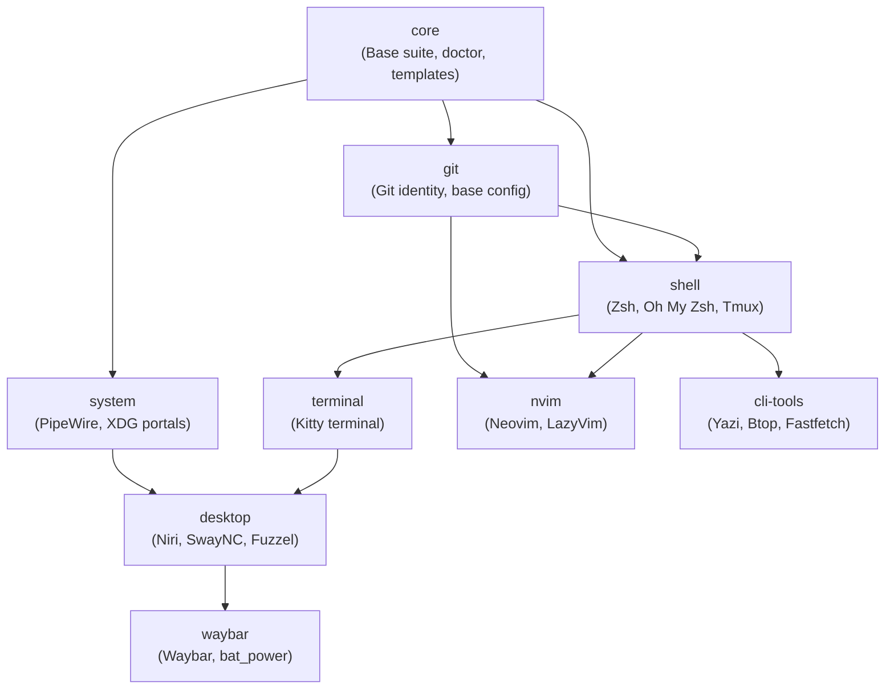

# Dotfiles Infrastructure Specification

This repository contains the configuration management and infrastructure-as-code deployment for a developer workstation on Arch Linux. Configuration files are managed directly within the user environment utilizing a Bare Git Repository architecture combined with Git Sparse-Checkout (`--no-cone` mode).

---

## 1. System Specifications

| Component | Technology | Description |
| :--- | :--- | :--- |
| Operating System | Arch Linux | Rolling release distribution, Linux kernel |
| Window Manager | Niri | Scrollable-tiling Wayland compositor |
| Shell | Zsh 5.9+ | Managed with Oh My Zsh framework, custom completions, and Tmux |
| Editor | Neovim 0.10+ | LazyVim framework with LSP, Treesitter, conform.nvim, and Neogit |
| Terminal Emulator | Kitty | GPU-accelerated terminal emulator, JetBrains Mono Nerd Font |
| Status Bar | Waybar | Wayland status bar with native C battery polling utility (`bat_power`) |
| Notifications | SwayNC | Sway Notification Center for Wayland |
| Application Launcher | Fuzzel | Wayland-native dynamic application menu |
| Audio Subsystem | PipeWire / WirePlumber | Low-latency audio server and session routing manager |
| CLI Toolchain | Yazi, Btop, Fastfetch, MPV | Modern Rust/C++ system utilities, zoxide, and fzf integration |

---

## 2. Core Architecture

### 2.1. Bare Git Repository Pattern

Rather than housing configuration files in a conventional repository subdirectory and establishing symlinks, this environment employs a Bare Git Repository:

- Repository Database Path: `$HOME/.dotfiles.git` (configurable via `$DOTFILES_DIR`)
- Working Tree Root: `$HOME` (configurable via `$DOTFILES_WORK_TREE`)
- Status Flag: `status.showUntrackedFiles no`

```
$HOME/ (Working Tree)
├── .config/
│   ├── niri/
│   ├── nvim/
│   └── waybar/
├── .zshrc
├── .gitconfig
└── .dotfiles.git/ (Bare Git Database: objects, refs, HEAD, config)
```

By pointing the Git directory to a hidden bare clone and the working tree to `$HOME`, tracked files reside directly at their canonical filesystem paths. Setting `status.showUntrackedFiles no` suppresses tracking notifications for untracked user directories in `$HOME`, preserving a deterministic `git status` output.

### 2.2. Sparse-Checkout (`--no-cone` Mode)

Sparse-checkout restricts the working tree to a subset of files from the repository object database. This infrastructure mandates non-cone mode (`--no-cone`):

```bash
git --git-dir=$HOME/.dotfiles.git --work-tree=$HOME sparse-checkout set --no-cone <patterns...>
```

#### Architectural Rationale for Non-Cone Mode

Default Git cone mode restricts inclusion rules to directory matches (`dir/`), prohibiting individual file matching or specific nested filters. Non-cone mode allows standard `.gitignore`-style pattern syntax, enabling:

- Granular file selection at root level (for example: `/.gitignore`, `/.zshrc`, `/README.md`, `/.local/bin/dotfiles-doctor`) without checking out neighboring unmanaged root files.
- Modular isolation of specific application subdirectories inside `~/.config/` while skipping heavy or unneeded directories.
- Dynamic profile compilation where only the exact paths associated with active modules are populated on disk.

### 2.3. Rationale Over Symlink Managers (Stow, Chezmoi)

| Evaluation Criteria | Bare Git + Sparse-Checkout | GNU Stow | Chezmoi |
| :--- | :--- | :--- | :--- |
| Filesystem Indirection | Zero (files reside natively at target paths) | High (nested symlink hierarchies) | Zero (files copied to target) |
| External Dependencies | None (standard Git 2.28+) | Perl and GNU Stow package | Go binary runtime |
| Broken Link Vulnerability | None (no symlinks) | High (parent directory deletions break links) | None |
| Modification Overhead | Direct in-place editing; immediate Git tracking | In-place editing via symlink resolution | Two-phase sync (`chezmoi edit` / `chezmoi apply`) |
| Partial / Modular Installs | Native via Git sparse-checkout engine | Manual stow directory tree partitioning | Configured via custom Go templating |
| Execution Footprint | Zero background daemons or runtime wrappers | Zero runtime daemon | Zero runtime daemon |

The bare Git repository with sparse-checkout provides complete version control ergonomics with zero filesystem indirection, no intermediate compilation step, and zero third-party dependencies on fresh nodes.

---

## 3. Security and Credential Isolation Model (Zero-Leak)

To prevent accidental exposure of cryptographic identities, private keys, authentication tokens, and system-specific paths in public or shared repositories, this configuration enforces a three-tier isolation architecture.

### 3.1. Machine-Local Split Pattern (`*.local`)

Runtime configurations explicitly partition generic logic from machine-specific values:

```
[System Domain]               [Local Machine Domain - Untracked]
~/.gitconfig          ----->  ~/.gitconfig.local  (User identity, GPG signing key)
~/.zshrc              ----->  ~/.zshrc.local      (API tokens, network secrets, overrides)
~/.bashrc             ----->  ~/.bashrc.local     (Host environment overrides)
```

1. Git Identity (`~/.gitconfig`):
   ```ini
   [include]
       path = ~/.gitconfig.local
   ```
   Committer name, email addresses, and credential helpers reside exclusively in `~/.gitconfig.local`.

2. Shell Environment (`~/.zshrc`):
   ```zsh
   if [[ -f "$HOME/.zshrc.local" ]]; then
       source "$HOME/.zshrc.local"
   fi
   ```
   API keys (`OPENAI_API_KEY`, `GITHUB_TOKEN`), private proxy endpoints, and institutional configuration variables are isolated in `~/.zshrc.local`.

3. Access Control:
   The installer automatically provisions missing `.local` template files with restricted POSIX permissions:
   ```bash
   chmod 600 ~/.zshrc.local ~/.gitconfig.local
   ```

### 3.2. Multi-Layered `.gitignore` Safeguards

The repository root `.gitignore` enforces exclusion across five operational risk categories:

- Cryptographic Keys and Keychains: `.ssh/`, `.gnupg/`, `.password-store/`, `**/*.pem`, `**/*.key`, `**/*.keystore`, `**/*.p12`, `**/*.pfx`, `.config/InputLeap/SSL/`.
- Authentication Tokens and Session Profiles: `.config/gh/hosts.yml`, `.config/msga/`, `.config/miupv/`, `.config/wayspot-lyrics/config.toml`, `.config/remmina/`, `.aws/`, `.gemini/`, `.android/`, `.copilot/`.
- Local Overrides: `*.local`, `*.local.*`, `*.env`, `*.env.*`, `.zshrc.local`, `.gitconfig.local`, `.bashrc.local` (with explicit exceptions for `!/.local/` and `!/.local/bin/`).
- Interactive Histories and Runtime Dumps: `.*_history`, `*.history`, `*-history.txt`, `*.log`, `.wget-hsts`, `.zcompdump*`, `.config/ffuf/history/`.
- Application Caches and Browser Profiles: `.config/zen/`, `.config/mozilla/`, `.config/vesktop/`, `.config/spotify/`, `.config/obsidian/`, `.config/Trae/`, `.config/Code - OSS/`, `.cache/`, `.local/state/`.

### 3.3. Static Secret and Integrity Analysis (`dotfiles-doctor`)

The executable utility `~/.local/bin/dotfiles-doctor` executes automated static analysis on the bare repository prior to commits.

```
dotfiles-doctor Execution Pipeline
[Phase 1: File Inventory]   Collect tracked or staged files via Git index
         │
[Phase 2: Path Auditing]    Evaluate paths against 20+ blacklisted pattern rules
         │
[Phase 3: Content Scan]     Grep regex signatures (AWS, GitHub PATs, Slack, PEM headers)
         │
[Phase 4: Sanity Audit]     Verify Git showUntrackedFiles=no and root .gitignore
         │
[Evaluation & Exit]         Exit 0 (clean) or Exit 1 (blocking failure with remediation)
```

Key features:
- Staged-Only Inspection: Option `--staged-only` allows pre-commit hook integration to inspect only pending changes.
- Content Pattern Signatures: Scans for GitHub tokens (`ghp_`, `github_pat_`), AWS Access Keys (`AKIA...`), Slack OAuth tokens (`xox[baprs]-`), and unencrypted/encrypted private key headers.
- Log Masking: Flagged matches are automatically truncated and redacted in terminal output to prevent secondary exposure during screen sharing or logging.

---

## 4. Modular Dependency Graph

Modules are organized as a Directed Acyclic Graph (DAG). High-level desktop components declare explicit prerequisites, allowing the installation engine to perform recursive topological dependency resolution.

### 4.1. Topological Dependency Graph



### 4.2. Module Specification and Arch Linux Package Mapping

| Module | Direct Prerequisites | Managed Files and Directory Patterns | Arch Linux Packages |
| :--- | :--- | :--- | :--- |
| `core` | None | `/.gitignore`, `/README.md`, `/install-dotfiles.sh`, `/.local/bin/dotfiles-doctor` | `base-devel`, `git` |
| `git` | `core` | `/.gitconfig`, `~/.gitconfig.local` template | `git`, `github-cli` |
| `shell` | `core`, `git` | `/.bashrc`, `/.zshrc`, `/.zprofile`, `/.tmux.conf`, `/.zfunc/` | `zsh`, `tmux`, `zoxide`, `fzf`, `thefuck` |
| `system` | `core` | `/.config/wireplumber/`, `/.config/xdg-desktop-portal/`, `/.config/user-dirs.*`, `/.config/mimeapps.list`, `/.config/systemd/user/obex.service.d/` | `xdg-desktop-portal-wlr`, `wireplumber`, `pipewire` |
| `terminal` | `shell` | `/.config/kitty/` | `kitty`, `ttf-jetbrains-mono-nerd` |
| `desktop` | `system`, `terminal` | `/.config/niri/`, `/.config/swaync/`, `/.config/fuzzel/`, `/Wallpapers/` | `niri`, `swaybg`, `swaync`, `fuzzel`, `cliphist`, `wl-clipboard` |
| `waybar` | `desktop` | `/.config/waybar/` | `waybar`, `gcc` |
| `nvim` | `git`, `shell` | `/.config/nvim/` | `neovim`, `ripgrep`, `fd` |
| `cli-tools` | `shell` | `/.config/yazi/`, `/.config/btop/`, `/.config/fastfetch/`, `/.config/mpv/`, `/.config/thefuck/`, `/.config/wayspot-lyrics/`, `/.local/bin/w-disc`, `/.jc141rc` | `yazi`, `btop`, `fastfetch`, `mpv` |

---

## 5. Deployment and Command Reference

### 5.1. Fresh Machine Installation

#### Remote Bootstrap (One-Liner)

```bash
curl -fsSL https://raw.githubusercontent.com/Manel-Romero/dotfiles/main/install-dotfiles.sh | bash
```

#### Manual Bootstrap (Git Clone)

```bash
git clone --bare https://github.com/Manel-Romero/dotfiles.git $HOME/.dotfiles.git
git --git-dir=$HOME/.dotfiles.git --work-tree=$HOME checkout -f main
bash $HOME/install-dotfiles.sh --profile=desktop
```

### 5.2. Profile Presets

The installation script (`install-dotfiles.sh`) provides predefined profiles suited for specific target roles:

```bash
# Minimal server or container deployment (core, git, shell)
./install-dotfiles.sh --profile=minimal

# Headless development workstation (core, git, shell, terminal, nvim, cli-tools)
./install-dotfiles.sh --profile=dev

# Full Wayland workstation (all modules)
./install-dotfiles.sh --profile=desktop
```

### 5.3. Granular Module Management

```bash
# Install a specific module and automatically resolve its dependencies
./install-dotfiles.sh --modules=nvim

# Install multiple discrete modules
./install-dotfiles.sh --modules=waybar,cli-tools

# Incrementally add a module to an existing installation without removing active patterns
./install-dotfiles.sh --add-module=cli-tools

# Simulate dependency resolution and pattern assignment without disk writes
./install-dotfiles.sh --profile=desktop --dry-run

# Automatically install missing Arch Linux packages via pacman or yay
./install-dotfiles.sh --profile=desktop --packages

# Skip post-install compilation of native helpers (e.g., bat_power.c)
./install-dotfiles.sh --profile=desktop --no-compile
```

### 5.4. Installation Script CLI Parameter Reference

| Parameter | Shorthand | Description | Default |
| :--- | :--- | :--- | :--- |
| `--modules=<list>` | `-m` | Comma-separated list of modules to install | None |
| `--profile=<name>` | `-p` | Preset profile (`minimal`, `dev`, `desktop`, `all`) | None |
| `--add-module=<mod>` | `-a` | Add module to current active sparse-checkout set | None |
| `--interactive` | `-i` | Launch interactive terminal selection menu | False (TTY auto-detected) |
| `--list-modules` | `-l` | Display module metadata, dependencies, and packages | False |
| `--packages` | None | Verify and install missing packages with `pacman`/`yay` | False |
| `--dry-run` | None | Print calculated actions without executing | False |
| `--git-dir=<path>` | None | Path to bare Git repository | `$HOME/.dotfiles.git` |
| `--work-tree=<path>`| None | Destination working directory | `$HOME` |
| `--repo=<url>` | None | Source repository URL | Repository origin URL |
| `--no-compile` | None | Bypass compilation of C helper binaries | False |
| `--help` | `-h` | Display usage instructions | False |

### 5.5. Day-to-Day Bare Git Operations

An operational alias is configured in `~/.zshrc` and `~/.bashrc`:

```bash
alias dotfiles='/usr/bin/git --git-dir=$HOME/.dotfiles.git/ --work-tree=$HOME'
```

#### Routine Maintenance Workflow

1. Query Working Tree Status:
   ```bash
   dotfiles status
   ```

2. Stage Modified or New Configuration Files:
   ```bash
   dotfiles add ~/.config/niri/config.kdl
   ```

3. Execute Static Security Audit on Staged Content:
   ```bash
   dotfiles-doctor --staged-only
   ```

4. Commit and Push to Remote:
   ```bash
   dotfiles commit -m "feat(niri): update workspace layout binds"
   dotfiles push origin main
   ```

5. Inspect Active Sparse-Checkout Patterns:
   ```bash
   dotfiles sparse-checkout list
   ```

6. Fetch and Integrate Remote Upstream Changes:
   ```bash
   dotfiles pull --rebase origin main
   ```

---

## 6. Recovery and Conflict Resolution

### 6.1. Automated Conflict Backup Mechanism

When checking out configuration files into an active `$HOME` directory on a pre-existing system, native Git checkouts fail if unmanaged local files occupy paths defined in the repository.

The installer integrates an automated conflict mitigation routine:

```
[git checkout]
      │
(Exit code != 0?)
      │
      ├──> Scan stderr for conflicting paths matching "^\s+"
      │
      ├──> Create isolation directory: $HOME/.dotfiles-backup-YYYYMMDD_HHMMSS/
      │
      ├──> Iterate conflicting paths, moving existing files into backup directory
      │    (Preserves full nested directory hierarchy)
      │
      └──> Re-execute [git checkout]
```

Example output during automated resolution:
```
[WARN] Pre-existing files in /home/manel would conflict. Backing them up...
[INFO] Moved conflicting file: .bashrc -> /home/manel/.dotfiles-backup-20261111_102500/.bashrc
[INFO] Moved conflicting file: .config/kitty/kitty.conf -> /home/manel/.dotfiles-backup-20261111_102500/.config/kitty/kitty.conf
[OK] Dotfiles checked out successfully after backing up conflicting files.
```

### 6.2. Manual Conflict Inspection and Rollback

If customized local configuration files were relocated by the backup mechanism, inspect and merge them using standard differential analysis tools:

```bash
# Locate latest backup directory
BACKUP_DIR=$(ls -td $HOME/.dotfiles-backup-* | head -1)

# Review differences against newly checked-out dotfiles
diff -u "${BACKUP_DIR}/.bashrc" "$HOME/.bashrc"

# Or compare interactively via Neovim
nvim -d "${BACKUP_DIR}/.config/kitty/kitty.conf" "$HOME/.config/kitty/kitty.conf"
```

To fully restore a backed-up file, overwrite the target path or unstage the dotfile:

```bash
cp -a "${BACKUP_DIR}/.bashrc" "$HOME/.bashrc"
```
